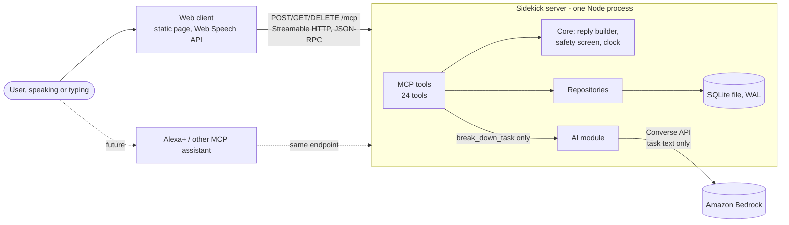

# Architecture

Status: Draft v1 · Implements PRD §8–§10 · Decisions: [DECISIONS.md](DECISIONS.md)

## 1. Context



Boundaries that matter:
- **Only `break_down_task` talks to Bedrock**, and only the task text crosses the boundary (PRD §8 privacy).
- **The server is the product.** The web client is a thin MCP client plus a rule-based intent router. Any MCP-capable assistant can use the same `/mcp` endpoint.
- **One process, one SQLite writer.** No queue, no cache, no second service.

## 2. Runtime stack

| Concern | Choice | Why (see ADR) |
|---|---|---|
| Language/runtime | TypeScript, Node >= 22.13 | Existing starter; ADR-001 |
| MCP | `@modelcontextprotocol/sdk` (version verified in T-003) | ADR-002 |
| HTTP | Express 5 (already in starter) | reuse |
| Storage | `node:sqlite` (built in), WAL, sync API | no native build for judges; ADR-003 |
| AI | `@aws-sdk/client-bedrock-runtime`, `ConverseCommand` | PRD §8; ADR-005 |
| Validation | zod (already in starter) | reuse |
| Tests | `node --test` | reuse |
| Web client | Plain HTML + ES modules, no bundler | zero build step; ADR-006 |

## 3. Source layout (target)

```
src/
  index.ts                  entry (unchanged)
  config.ts                 zod-validated env, single source of config
  server/
    boot.ts                 stdio | http; http = session map, Origin check, static files, /healthz
    sessions.ts             per-session McpServer + transport lifecycle
  core/
    clock.ts                injectable now(); UTC epoch seconds; local-date helper
    user.ts                 resolveUserId(ctx) -> "default" (seam for Alexa+ identity)
    reply.ts                speak(): builds + lints every outgoing text
    lexicon.ts              banned words, crisis phrases (data, not logic)
    safety.ts               crisis screen for free-text inputs
    timewords.ts            "about 12 minutes", "a few minutes ago"
    log.ts                  JSON-line logger: tool, ok, ms. Never args/content
  db/
    connection.ts           open file, pragmas, run migrations
    migrations/001_init.sql
    repos/                  tasks, dump, wins, parked, focus, routines, dopamine, aiCalls, userData
  ai/
    types.ts                AiClient interface: breakDown(task, signal) -> unknown
    bedrock.ts              Converse adapter (only file importing the AWS SDK)
    mock.ts                 canned steps
    prompt.ts               system prompt + toolSpec
    validate.ts             parse + normalise + validate -> steps | error class
    fallback.ts             fixed template
    breakdown.ts            orchestration: budget, retry once, fallback, ai_calls logging
  tools/                    one auto-loaded module per domain, each registers several tools
    tasks.ts  time.ts  memory.ts  decisions.ts  wins.ts  dopamine.ts  routines.ts  data.ts
  web/public/
    index.html  app.js  mcp-client.js  router.js  styles.css
tests/                      mirrors src/; tests/helpers gains in-memory DB + fake AiClient
docs/                       this folder
```

Starter files removed in T-001: `tools/echo.ts`, `prompts/*`, `resources/*` and their tests.
`registry/` auto-loader is kept. T-003 checks it accepts a module that registers several tools.

## 4. Key flows

### 4.1 Hero flow: "I need to clean the kitchen"

```mermaid
sequenceDiagram
  participant U as User
  participant W as Web client
  participant S as /mcp
  participant BT as tasks.break_down_task
  participant AI as ai/breakdown
  participant BR as Bedrock
  participant DB as SQLite
  U->>W: "I need to clean the kitchen"
  W->>S: initialize / notifications/initialized (once)
  W->>S: tools/call break_down_task {task}
  S->>BT: handler
  BT->>BT: safety.screen(task)  (crisis -> care reply, stop)
  BT->>AI: breakDown(task)
  AI->>BR: Converse (forced tool, timeout)
  BR-->>AI: {steps:[...]}
  AI->>AI: validate; on failure retry once, then fallback
  AI->>DB: ai_calls row (no text)
  AI-->>BT: steps, source = ai|fallback|mock
  BT->>DB: tx: insert parent task + steps
  BT-->>S: text = first step only, _meta = {source, latencyMs}
  S-->>W: result
  W-->>U: speaks reply, shows tool-call panel
```

### 4.2 Reply pipeline (enforces AC1 and AC2 for all tools)

Every handler returns `speak(parts)` from `core/reply.ts`. `speak` sanitises echoed user text, asserts at most 3 sentences, plain text, and no banned words in template text. A violation throws in tests and CI, and degrades to a safe generic sentence in production. No tool builds its own `content` array. Details: [SAFETY-COPY.md](../specs/SAFETY-COPY.md).

### 4.3 Failure handling

| Failure | Behaviour |
|---|---|
| Bedrock timeout / throttle / auth / network | retry once if budget remains, else fallback template; reply is normal, `_meta.source = "fallback"` |
| Model output malformed / wrong count / banned word | same as above |
| SQLite error | tool returns `isError: true` with a calm fixed sentence; error class logged, no content |
| Unknown/invalid tool input | zod error mapped to one-question reply ("What task should I break down?") |
| Crisis phrase in input | care reply, nothing stored, not an error |

The user never hears a stack trace, a status code, or the word "error".

## 5. Cross-cutting design rules

1. **Single caller seam.** All repo calls take `userId` from `resolveUserId`. v1 returns `"default"`. When Alexa+ identity is known, only `core/user.ts` changes.
2. **Injectable clock and AI client.** Time logic and AI behaviour are tested without sleeping or AWS.
3. **Privacy logging.** `log.ts` accepts only `{tool, ok, ms, errClass?}`. There is no API to log arguments.
4. **Sync DB inside async handlers.** `node:sqlite` is synchronous; keep transactions short and never `await` inside one.
5. **Config only from `config.ts`.** No `process.env` reads elsewhere. Validation runs at boot and fails fast with a readable message.

## 6. Configuration

| Var | Default | Purpose |
|---|---|---|
| `STARTER_TRANSPORT` | `stdio` (npm start sets `http`) | transport mode (name kept from starter) |
| `PORT` / `SIDEKICK_HOST` | `3000` / `127.0.0.1` | bind address |
| `SIDEKICK_DB_PATH` | `./data/sidekick.db` | SQLite file |
| `SIDEKICK_TZ` | system TZ | local-day boundaries (routines, "today") |
| `SIDEKICK_MOCK_AI` | unset | `1` = canned steps, no AWS |
| `AWS_REGION` | none (required unless mock) | Bedrock region |
| `SIDEKICK_BEDROCK_MODEL_ID` | none (required unless mock; Q1) | model or inference profile id |
| `SIDEKICK_AI_TIMEOUT_MS` | `2500` | per-attempt timeout |
| `SIDEKICK_AI_BUDGET_MS` | `4500` | total budget incl. retry |
| `SIDEKICK_ALLOWED_ORIGINS` | same-origin + localhost | Origin allow-list |
| `SIDEKICK_AUTH_TOKEN` | unset | optional bearer token (P1) |
| `CORS_ORIGIN` | removed | replaced by allow-list |

AWS credentials use the SDK default chain; Sidekick never reads or logs them.

## 7. Deployment

- **Judge/dev path:** `npm ci && npm start` (build then HTTP on 127.0.0.1:3000). Web client at `/`, MCP at `/mcp`.
- **Docker:** existing `Dockerfile`/`docker-compose.yml` adapted: volume for `data/`, env passthrough.
- **Not Lambda** (PRD risk R2): ephemeral storage. Documented in README.
- **Exposing to a remote assistant:** put behind a tunnel or reverse proxy, set `SIDEKICK_AUTH_TOKEN` and `SIDEKICK_ALLOWED_ORIGINS`. Not required for the demo.

## 8. Known gaps in the starter that this design fixes

| Starter behaviour (`src/server/boot.ts`) | Problem | Fix |
|---|---|---|
| One `StreamableHTTPServerTransport` shared by every client | A second `initialize` is rejected; reconnecting after page reload fails | Per-session transport + server map (ADR-004) |
| `CORS_ORIGIN` defaults to `*` with `credentials: true` | Any web page can drive a local server with delete tool | Origin allow-list; bind 127.0.0.1 |
| Server name/version are placeholders | Shows up in `initialize` result | Set to `sidekick` / package version |
| Logs with `console.log` | Easy to leak content | `core/log.ts` |
