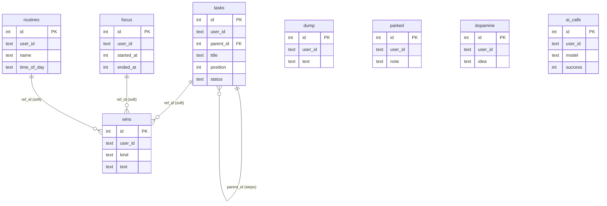

# Data model

Status: Draft v1 · Implements PRD §9 · Engine: SQLite via `node:sqlite` (ADR-003)

## 1. Rules

- One file, `SIDEKICK_DB_PATH`. Pragmas on open: `journal_mode=WAL`, `synchronous=NORMAL`, `foreign_keys=ON`, `busy_timeout=3000`.
- Every table has `user_id TEXT NOT NULL` (v1 value `"default"`) and every query filters on it. Repositories take `userId` as the first argument; there is no query without it.
- Times: `INTEGER` UTC epoch **seconds**. Local dates (`routines.last_done_on`) are `TEXT 'YYYY-MM-DD'` in `SIDEKICK_TZ`. Display conversion only in `core/timewords.ts` and `core/clock.ts`.
- Booleans are `INTEGER 0/1` with `CHECK`. Enums are `TEXT` with `CHECK`.
- Single process, single writer. Multi-statement writes use `BEGIN IMMEDIATE ... COMMIT` helpers (`tx(db, fn)`); no `await` inside.
- Migrations: numbered SQL files, applied in order inside a tx, tracked in `schema_migrations`. Forward-only; v1 ships `001_init.sql`.

## 2. ER overview


`wins.ref_id` is a soft reference (no FK) so deleting or archiving a source never blocks or rewrites history.

## 3. DDL (`001_init.sql`)

```sql
CREATE TABLE schema_migrations (
  version    INTEGER PRIMARY KEY,
  applied_at INTEGER NOT NULL
);

-- A parent task has parent_id NULL and position 0; its steps have parent_id = parent.id, position 1..n.
CREATE TABLE tasks (
  id           INTEGER PRIMARY KEY,
  user_id      TEXT    NOT NULL,
  parent_id    INTEGER REFERENCES tasks(id) ON DELETE CASCADE,
  title        TEXT    NOT NULL,
  position     INTEGER NOT NULL DEFAULT 0,
  status       TEXT    NOT NULL DEFAULT 'open' CHECK (status IN ('open','done','archived')),
  source       TEXT    CHECK (source IN ('ai','fallback','mock')),   -- parent rows only
  created_at   INTEGER NOT NULL,
  updated_at   INTEGER NOT NULL,
  completed_at INTEGER,
  CHECK ((parent_id IS NULL AND position = 0) OR (parent_id IS NOT NULL AND position >= 1))
);
CREATE INDEX tasks_user_parent_status ON tasks (user_id, parent_id, status, position);
CREATE INDEX tasks_user_active        ON tasks (user_id, status, updated_at DESC) WHERE parent_id IS NULL;

CREATE TABLE dump (
  id          INTEGER PRIMARY KEY,
  user_id     TEXT    NOT NULL,
  text        TEXT    NOT NULL,
  created_at  INTEGER NOT NULL,
  archived_at INTEGER
);
CREATE INDEX dump_user_created ON dump (user_id, created_at DESC);

CREATE TABLE wins (
  id         INTEGER PRIMARY KEY,
  user_id    TEXT    NOT NULL,
  kind       TEXT    NOT NULL CHECK (kind IN ('step','task','focus','routine','manual')),
  text       TEXT    NOT NULL,
  ref_id     INTEGER,
  created_at INTEGER NOT NULL
);
CREATE INDEX wins_user_created ON wins (user_id, created_at DESC);

CREATE TABLE parked (
  id         INTEGER PRIMARY KEY,
  user_id    TEXT    NOT NULL,
  note       TEXT    NOT NULL,
  created_at INTEGER NOT NULL
);
CREATE INDEX parked_user_created ON parked (user_id, created_at DESC);

CREATE TABLE focus (
  id              INTEGER PRIMARY KEY,
  user_id         TEXT    NOT NULL,
  label           TEXT,
  planned_minutes INTEGER CHECK (planned_minutes IS NULL OR planned_minutes BETWEEN 1 AND 240),
  started_at      INTEGER NOT NULL,
  ended_at        INTEGER
);
CREATE UNIQUE INDEX focus_one_open ON focus (user_id) WHERE ended_at IS NULL;

CREATE TABLE routines (
  id           INTEGER PRIMARY KEY,
  user_id      TEXT    NOT NULL,
  name         TEXT    NOT NULL,
  time_of_day  TEXT    CHECK (time_of_day IS NULL OR time_of_day GLOB '[0-2][0-9]:[0-5][0-9]'),
  last_done_on TEXT,
  created_at   INTEGER NOT NULL,
  archived_at  INTEGER
);
CREATE INDEX routines_user ON routines (user_id) WHERE archived_at IS NULL;

CREATE TABLE dopamine (
  id           INTEGER PRIMARY KEY,
  user_id      TEXT    NOT NULL,
  idea         TEXT    NOT NULL,
  is_default   INTEGER NOT NULL DEFAULT 0 CHECK (is_default IN (0,1)),
  last_used_at INTEGER,
  created_at   INTEGER NOT NULL
);
CREATE INDEX dopamine_user_used ON dopamine (user_id, last_used_at);

CREATE TABLE ai_calls (
  id          INTEGER PRIMARY KEY,
  user_id     TEXT    NOT NULL,
  model       TEXT    NOT NULL,          -- configured id, or 'mock' / 'fallback'
  attempt     INTEGER NOT NULL,
  success     INTEGER NOT NULL CHECK (success IN (0,1)),
  error_class TEXT,                      -- timeout|throttled|auth|network|malformed|count|empty|too_long|banned|dupe|markup|other
  latency_ms  INTEGER NOT NULL,
  created_at  INTEGER NOT NULL
);
CREATE INDEX ai_calls_user_created ON ai_calls (user_id, created_at DESC);
```

PRD delta: `ai_calls` is new (PRD §9). Added beyond PRD column lists: `archived_at`, `status`, `source`, `last_used_at`, `planned_minutes` (see §6).

## 4. Seeds

`dopamine` defaults are inserted lazily per user on first `dopamine_menu`/`what_now`/`match_energy` read (`ensureSeeded(userId)`, `is_default=1`): stretch for one minute; drink a glass of water; step outside for fresh air; put on one favourite song; do ten slow breaths; walk to another room and back; text a friend a silly emoji; doodle for two minutes. Defaults are not deleted by `gentle_reset`; `delete_my_data` removes them (re-seeded on next use).

## 5. Query catalogue (canonical, with index used)

| Name | Used by | SQL sketch |
|---|---|---|
| activeTask | next/complete/park | `SELECT * FROM tasks WHERE user_id=? AND parent_id IS NULL AND status='open' ORDER BY updated_at DESC LIMIT 1` |
| currentStep | next/complete | `... WHERE user_id=? AND parent_id=? AND status='open' ORDER BY position LIMIT 1` |
| completeStep (tx) | complete_step | update step done; touch parent `updated_at`; insert win; if no open step, update parent done + win |
| openFocus | focus tools, what_now | `WHERE user_id=? AND ended_at IS NULL` (unique index guarantees <= 1) |
| recentDump | sort_dump | `WHERE user_id=? AND archived_at IS NULL ORDER BY created_at DESC LIMIT 6` (6th row tells "and more") |
| lastParked | where_was_i | `WHERE user_id=? ORDER BY created_at DESC LIMIT 1` |
| winsSince | my_wins | `WHERE user_id=? AND created_at >= ? ORDER BY created_at DESC` |
| dueRoutine | routine_check, what_now | filter in JS using local time: active, `last_done_on IS NOT today`, `time_of_day` null or reached; order by `time_of_day` |
| nextBreak | dopamine_menu | `ORDER BY last_used_at IS NOT NULL, last_used_at LIMIT 1` then stamp |
| deleteAll (tx) | delete_my_data | `DELETE FROM <t> WHERE user_id=?` for all 8 tables, child rows first |

## 6. Interpretation notes (PRD silent) 

| Topic | Decision |
|---|---|
| Steps live in `tasks` | Per PRD "step points to parent" via `parent_id`. |
| Task lifecycle | `open -> done`, or `open -> archived` (gentle_reset). Nothing is "overdue"; there is no due date. |
| `source` on parent | Lets the UI/demo show whether steps came from Bedrock; never spoken. |
| Wins never deleted | Except by `delete_my_data`. `gentle_reset` keeps them. |
| Retention | None in v1. A single user's volume is tiny. |
| Backup | Copy the file while server is stopped or use `VACUUM INTO`. Documented in README. |
| Size/time | Epoch seconds avoid DST bugs; local-day logic uses `Intl.DateTimeFormat` with `SIDEKICK_TZ`. |
| Multi-user later | Add `users` table and FK; today `user_id` is just a partition key. No cross-user query exists to refactor. |
